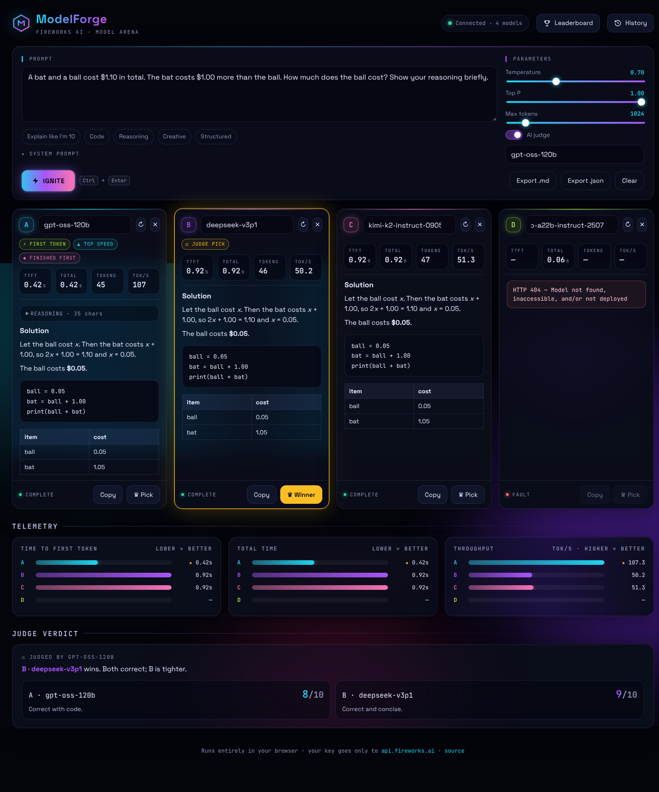

# ModelForge

**Race Fireworks AI models side by side.** ModelForge is a single-file web app with a neon, futuristic interface. It streams one prompt to 2–4 [Fireworks AI](https://fireworks.ai) models at the same time and shows live stats for each.



## Features

- **Bring your own key.** Your Fireworks API key goes from your browser straight to `api.fireworks.ai`. You can keep it on your device or just for the browser session.
- **2–4 model lanes** with streamed output. The model list is loaded from your account, and you can also type any model ID.
- **Live stats** for every lane: time to first token, total time, tokens, and tokens/sec. A telemetry panel compares the lanes as bar charts.
- **Badges** for first token, top speed, and finished first.
- **Reasoning output** (`reasoning_content` or `<think>` blocks) goes in a collapsible panel.
- **Markdown rendering** with syntax-highlighted code and copy buttons.
- **AI judge** (optional): a third model scores the anonymized answers and picks a winner.
- **Winner voting** feeds a local **leaderboard** of wins, runs, average tok/s, and average TTFT.
- **History** of past runs, which you can reload. Export runs as **Markdown** or **JSON**.
- System prompt, temperature, top-p, max tokens, prompt presets, a per-lane re-run button, Stop/Esc, and <kbd>Ctrl</kbd>+<kbd>Enter</kbd> to run.

## Run

There is no build step. Open `index.html` in a browser, or serve the folder:

```bash
python3 -m http.server 8000
# open http://localhost:8000
```

To host it for free, enable **GitHub Pages** for this repo: Settings → Pages → Deploy from branch → `main` / root.

All data (key, history, leaderboard) stays in your browser's `localStorage`.

## Legacy Streamlit version

The original minimal Streamlit app lives in [`streamlit/`](streamlit/):

```bash
cd streamlit && pip install -r requirements.txt && streamlit run app.py
```
